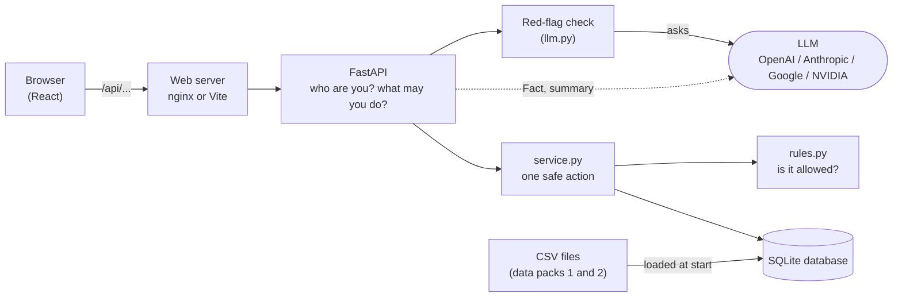

# 👁️ NetraCare: Clinic Booking Website + First AI Features (Iteration 2)

A website for a (fictional) eye clinic. Patients book appointments, Staff manage the day, Doctors see their schedule.
Iteration 2 adds three small AI features on top of the Iteration 1 website. **The AI never decides a booking:** every booking
still goes through the same plain-Python clinic rules.

> All data is synthetic (course data packs 1 and 2).

---

## ✨ What's new in Iteration 2

| Feature | What it does | AI or plain code? |
|---|---|---|
| 🛡️ **Red-flag check** | When someone books, the reason is checked. A sight-threatening symptom shows an emergency message in red and creates an **urgent case** for Staff. | AI decides *red flag or not*. Code shows the message, saves the case and runs the booking rules. |
| 💡 **Fact of the Day** | Patients see a short, friendly eye fact when they log in, and can press Refresh for a different one. **The fact is saved for each patient**, so the next login shows it instantly and Refresh replaces it. | AI writes the fact. Code saves it and adds the line "General information, not medical advice". |
| 📝 **Doctor summary** | A doctor opens a patient and sees a summary of the recorded notes **streaming onto the screen**, in three sections (Today, Background, Past visits). **Every past visit shows its date.** | AI writes only the wording of each visit's note. Code fills Today, Background, and every date, doctor and speciality from the records, limits it to 120 words and labels it. |
| 🔔 **Urgent badge** | Staff see a badge with the number of unseen urgent cases (also in the browser tab title). | Plain code |
| ✍️ **Reason** (required) | The booking form asks "What is the reason for your visit?" (up to 300 characters). | Plain code |
| 📋 **Doctor note** (required) | A doctor writes a note when marking a visit completed. | Plain code |

More detail on the stretch goals is in [section 'Stretch goals'](#-stretch-goals) below.

**If the AI is not available** the app still works, but safely: the Fact shows a fixed fallback fact, the summary says
"Summary unavailable. See the notes below.", and **booking is refused** ("We couldn't check your reason just now...") because the safety check cannot run.

## 🧑‍🤝‍🧑 What each role can do

| Role | Can do |
|---|---|
| 🧑 **Patient** | Log in, see a Fact of the Day, see doctors, see free times, book (with a reason), cancel, reschedule, see their own appointments |
| 🧑‍💼 **Staff** | Everything from Iteration 1 (all appointments, book for anyone, walk-ins, cancel, approvals, holidays, weekly schedules, week view) **plus** enter the reason when booking, see **urgent cases** at the top (red) and mark them seen, see the **Urgent** tag |
| 🩺 **Doctor** | See their schedule and each patient's reason, write a note when completing a visit, **open a patient to see the AI summary** and the full past notes |

## 🚀 Run it

**1. Set your AI key (optional, but needed for the AI features)**

Copy `backend/.env.example` to `backend/.env` and fill in one provider:
```
LLM_PROVIDER=nvidia            # openai, anthropic, google or nvidia
NVIDIA_API_KEY=nvapi-...       # the key for that provider
```
`.env` is listed in `.gitignore`, so it is never committed. Never put a key anywhere else.

**2. Start the app, with Docker (easiest)**
```bash
docker compose up --build
```
Open **http://localhost:5172**. API docs: http://localhost:8002/docs.
`docker compose down` stops it (data is kept); `docker compose down -v` deletes the data.
The key is passed to the container when it starts. It is **not** stored in the image.

**Or without Docker** (needs Python 3.10+ and Node.js 18+)
```bash
cd backend
pip install -r requirements.txt
python -m uvicorn app.main:app --port 8000
```
```bash
cd frontend
npm install
npm run dev
```
Open **http://localhost:5173**. The first start creates `backend/netracare.db` from the CSV files.

**Logging in** (no passwords, so this is classroom-level security only)

| Role | Enter |
|---|---|
| Patient | A mobile number and name from [`patients.csv`](backend/data/patients.csv), for example `9000000001` / `Asha Verma` |
| Staff | Any name |
| Doctor | Pick a name from the list |

## 🏗️ How it works



**Booking, step by step**
1. The patient (or Staff) fills in doctor, time and **reason** and clicks a time.
2. The server checks the login and role, and that the reason is not empty and is at most 300 characters.
3. **Red-flag check:** the reason goes to the AI, which answers in a fixed shape (`red_flag`, `category`, `why`). When it is unsure, it flags.
   - Red flag → the case is saved for Staff *before* anything else, and the emergency message is returned.
   - The check cannot run (no key, timeout, unreadable reply) → the booking is refused and nothing is saved.
4. **The normal clinic rules run, unchanged** (`rules.py`). If a rule fails, the booking is refused, but an urgent case from step 3 still stands.
5. If all rules pass, one row is saved, tagged **Urgent** if step 3 flagged it.

**What is AI and what is code**

| AI (language model) | Plain code |
|---|---|
| Is this reason a red flag, and which category | Whether a booking is allowed |
| The wording of the Fact of the Day | The emergency message and the caveat (word for word) |
| The wording of the doctor summary | Who may see what, the 120-word limit, the labels, all fallbacks |

The AI code is all in [`backend/app/llm.py`](backend/app/llm.py): three small LangChain chains (prompt, model, output parser). The red-flag chain uses a model setting of
temperature 0 and a Pydantic parser; the patient's text goes into the prompt as data between `<reason>` tags, not as instructions.

## 📋 Clinic rules (unchanged from Iteration 1)

Checked in this order, after the red-flag check. Each refusal has a short code and a plain sentence.

| # | Rule | Code |
|---|---|---|
| 1 | Start on a 10-minute mark (new consultation = 20 min, follow-up = 10 min) | `INVALID_START_TIME` |
| 2 | Not in the past | `IN_PAST` |
| 3 | At most 30 days ahead | `BEYOND_30_DAYS` |
| 4 | Not on a Sunday | `CLINIC_CLOSED` |
| 5 | Not on a holiday | `HOLIDAY` |
| 6 | Inside 09:00-13:00 or 14:00-18:00 | `OUTSIDE_SESSION` |
| 7 | Must finish before the session ends | `ENDS_AFTER_SESSION` |
| 8 | Doctor is at the clinic that session | `DOCTOR_OFF` |
| 9 | Doctor is not in surgery | `SURGERY_SESSION` |
| 10 | Doctor covers that speciality | `SPECIALITY_MISMATCH` |
| 11 | Slot is not already taken | `DOUBLE_BOOKED` |
| 12 | A follow-up needs a completed earlier visit, with the same doctor | `NO_PREVIOUS_VISIT`, `FOLLOW_UP_DIFFERENT_DOCTOR` |
| 13 | One active booking per speciality | `ACTIVE_BOOKING_EXISTS` |
| 14 | A patient can cancel or reschedule until 2 hours before. After that: "Please contact Staff" (the request is saved for Staff to approve or reject) | `INSIDE_2_HOURS` |

New in Iteration 2: `REASON_REQUIRED`, `REASON_TOO_LONG`, `NOTE_REQUIRED`, `NOTE_TOO_LONG`, `RED_FLAG_CHECK_FAILED`.

## 🔌 API

All paths start with `/api` in the browser (the web server removes it before calling FastAPI). Try them at `/docs`.
Protected calls need the header `Authorization: Bearer <token>`.

| Method | Path | Who | What it does |
|---|---|---|---|
| GET | `/health` | public | Is the server up, and what time does the clinic think it is |
| POST | `/login` | public | Log in as `patient`, `staff` or `doctor`; returns a token |
| GET | `/doctors` | public | The 5 doctors and their specialities |
| GET | `/me` | any logged-in user | Who am I |
| GET | `/schedule` | any logged-in user | Doctors' weekly schedule |
| GET | `/holidays` | any logged-in user | Clinic holidays |
| GET | `/slots` | any logged-in user | Free start times for a doctor, date, speciality and visit type |
| GET | `/appointments` | any logged-in user | List appointments (patients and doctors only see their own; only doctors see the doctor's note) |
| POST | `/appointments` | patient, staff | Book. Needs a `reason`. Runs the red-flag check first. |
| POST | `/appointments/{appointment_id}/cancel` | patient, staff | Cancel |
| POST | `/appointments/{appointment_id}/reschedule` | patient, staff | Move to another time (the old one is cancelled only if the new one is accepted) |
| POST | `/appointments/{appointment_id}/complete` | doctor | Mark the doctor's own visit completed. Needs a `note`. |
| GET | `/fact-of-the-day` | patient | The patient's saved eye fact (instant). `?refresh=true` writes a different one and saves it as the replacement. |
| GET | `/doctor/patients/{patient_id}/summary` | doctor | Structured AI summary of the recorded notes (`?appointment_id=` one on the doctor's own schedule) |
| GET | `/doctor/patients/{patient_id}/summary/stream` | doctor | The same summary streamed as it is written (server-sent events: `meta`, many `partial`, one `final`) |
| GET | `/urgent-cases` | staff | Urgent cases not yet seen |
| POST | `/urgent-cases/{urgent_id}/seen` | staff | Mark an urgent case seen |
| GET | `/patients` | staff | List patients |
| POST | `/patients` | staff | Register a walk-in patient |
| GET | `/staff/approvals` | staff | Late cancel/reschedule requests waiting for Staff |
| POST | `/staff/approvals/{approval_id}/approve` | staff | Approve and carry it out |
| POST | `/staff/approvals/{approval_id}/reject` | staff | Reject; the appointment stays |
| POST | `/holidays` | staff | Add a holiday |
| DELETE | `/holidays/{date}` | staff | Remove a holiday |
| PUT | `/schedule` | staff | Set a doctor's status (OPD, SURGERY or OFF) for a day and session |
| GET | `/calendar` | staff, doctor | One doctor's week (a doctor always gets their own) |

When a rule is broken the reply is HTTP 409 like this (a red-flag booking that is refused also carries an `emergency` object):
```json
{ "detail": { "code": "DOCTOR_OFF", "message": "Dr. Meera Iyer is not at the clinic on Thursdays.", "to_staff": false } }
```
Other errors: 401 not logged in, 403 not allowed for your role, 404 not found, 422 bad input, 503 the red-flag check could not run.

## 🗂️ Data

| Data pack | File | Rows | Used for |
|---|---|---|---|
| 1 | `backend/data/doctors.csv` | 5 | Doctors and their specialities |
| 1 | `backend/data/weekly_schedule.csv` | 60 | OPD / SURGERY / OFF for each doctor, day and session |
| 1 | `backend/data/holidays.csv` | 30 | Days the clinic is closed |
| 1 | `backend/data/patients.csv` | 25 | Patients |
| 1 | `backend/data/stretch/appointments_seed.csv` | 19 | Sample bookings, only if you ask; used by the tests |
| 1 | `backend/data/stretch/rule_tests.csv` | 38 | Test cases for the rules |
| 2 | `backend/data2/past_visits.csv` | 27 | Completed visits with the patient's reason and the doctor's note |
| 2 | `backend/data2/patient_profiles.csv` | 25 | General health and allergies |
| 2 | `backend/data2/reason_samples.csv` | 35 | Reasons labelled red flag yes/no, to test the AI check |

There are **no upcoming bookings** at the start. Data pack 2's 27 past visits are loaded as completed appointments, so follow-ups work (for example Asha Verma can book a Retina follow-up with Dr. Shah).

Settings (environment variables):

| Variable | Meaning |
|---|---|
| `LLM_PROVIDER` | `openai`, `anthropic`, `google` or `nvidia` (in `backend/.env`) |
| `LLM_MODEL` | Model name. If blank: `gpt-4o-mini`, `claude-haiku-5-5`, `gemini-2.0-flash` or `nvidia/nemotron-3.5-lightning-30b-a3b` |
| `LLM_TIMEOUT` | Seconds before an AI call gives up (default 20) |
| `LLM_MAX_RETRIES` | Retries after a short provider error such as HTTP 429 "too many requests" (default 2) |
| `LLM_FALLBACK_MODELS` | Optional backup models, comma separated (`provider:model`). Tried in order if the main model fails; booking is refused only if all of them fail. Blank = main model only |
| `NVIDIA_BASE_URL` | NVIDIA only: the API address (default `https://integrate.api.nvidia.com/v1`) |
| `NETRACARE_SEED_APPOINTMENTS` | Set to `1` to also load the 19 sample bookings |
| `NETRACARE_SKIP_PACK2` | Set to `1` to skip data pack 2 |
| `CLINIC_NOW` | Freeze the clinic clock, for example `2026-11-02T10:00` (demos and tests) |
| `CLINIC_TZ` | Docker only: the clinic's timezone (default `Asia/Kolkata`) |
| `NETRACARE_DB` | Where the SQLite file lives |
| `NETRACARE_DATA_DIR` | Where data pack 1 is |
| `NETRACARE_DATA2_DIR` | Where data pack 2 is |
| `BACKEND_PORT` | Dev server only: port of the backend (default `8000`) |

Plus the key for your provider: `OPENAI_API_KEY`, `ANTHROPIC_API_KEY`, `GOOGLE_API_KEY` or `NVIDIA_API_KEY`.

## 🎯 Stretch goals

| # | Stretch goal | Where it lives | How it was checked |
|---|---|---|---|
| 1 | Automated red-flag tests on all 35 rows | `tests/test_reason_samples_live.py` | Real model: 37 passed, 0 missed, 0 wrong category, 0 false alarms |
| 2 | 10 hard cases of my own (Hindi, Hinglish, typos, ambiguous, long) | `tests/hard_cases.csv`, `tests/test_hard_cases_live.py` | Real model: 10 of 10 correct, 0 false alarms |
| 3 | Structured summary (Today, Background, Past visits) | `llm.py` (`SummaryResult`), `App.jsx` (`SummarySections`) | Offline tests, real model, real browser |
| 4 | The visit date on every past-visit line | `llm.check_summary` | The code checks each date against the records; a summary with an invented or missing date is replaced by the fallback line |
| 5 | The summary streams onto the doctor's screen | `GET /doctor/patients/{id}/summary/stream` | Real model and real browser: the text grows in many steps |
| 6 | The Fact of the Day is saved for each patient | table `patient_facts`, `main.py` | Offline tests and real browser: the second login shows the same fact instantly; Refresh replaces it |
| 7 | Switch provider and model through `.env` only | `llm.py` (`openai`, `anthropic`, `google`, `nvidia`), `compare_models.py` | Env switching is tested offline. **No model comparison was completed**: `compare_models.py` is written and ready, but only NVIDIA's `nemotron-3.5-lightning` was measured (45 of 45 cases correct). Run `python compare_models.py provider:model provider:model` to compare others. |
| 8 | A badge with the number of unseen urgent cases | `UrgentBadge` in `App.jsx` | Real browser: 0, then 1, then 0 after Mark seen; the tab title follows |

## 🧪 Tests

```bash
cd backend
pip install -r requirements-dev.txt
python -m pytest -q --ignore-glob="tests/test_*_live.py"
```
**154 tests, all passing, with no API key and no internet.** They call the real API with a *scripted fake model*, so they prove the wiring, not how well a real model judges. They check
what goes into each prompt, the exact emergency text, urgent cases, required reasons and notes, who may call what, and every fallback.

| File | Tests | Checks |
|---|---|---|
| `test_iteration2.py` | 62 | Reasons, red-flag handling, urgent cases, doctor notes, Fact of the Day (saved and refreshed), structured and streamed doctor summary, no-key behaviour, audit fixes |
| `test_rule_cases.py` | 39 | All 38 cases in `rule_tests.csv` |
| `test_handout_checklist.py` | 26 | The Iteration 1 requirements and checklist |
| `test_stretch_goals.py` | 14 | Reschedule, approvals, holidays, schedule editing, week calendar |
| `test_roles_and_flows.py` | 13 | Logins, role limits, follow-ups, free slots |

**Live AI tests (need your key):**
```bash
python -m pytest tests/test_reason_samples_live.py -v   # the 35 reasons from data pack 2
python -m pytest tests/test_hard_cases_live.py -v       # my own 10 hard cases (Hindi, Hinglish, typos, ambiguous, long)
```
A missed red flag fails the test; a false alarm is allowed and reported.

## 📁 Project layout

```
backend/
  app/
    main.py       the API routes and role checks
    service.py    the actions (book, cancel, complete, urgent cases, ...)
    rules.py      every clinic rule
    llm.py        ALL the AI code: model setup, Fact of the Day, red-flag check, doctor summary
    db.py         database tables and CSV loading
    config.py     settings and the clinic clock
  data/           data pack 1 (CSV files)
  data2/          data pack 2 (CSV files)
  tests/          the automated tests (+ hard_cases.csv, my own 10 extra red-flag cases)
  compare_models.py   runs the same 45 red-flag cases on any models you name
  .env.example    copy to .env and add your key
frontend/
  src/App.jsx     all the screens
  src/api.js      talks to the API
docker-compose.yml   runs backend + frontend together
```

## 🛠️ Built with
Python, FastAPI, SQLite (no ORM), LangChain · React 18, Vite 5 · pytest · Docker Compose, nginx

## ⚠️ Limitations
- Logins have no passwords. Tokens never expire and there is no logout call.
- The AI can be slow or unavailable. The red-flag check then refuses the booking on purpose (you can reduce how often with `LLM_FALLBACK_MODELS`), so a patient with a real emergency is never booked silently, but routine patients must try again or call the clinic.
- A language model is not perfectly consistent: the same reason can occasionally be judged differently. That is why the check flags when unsure and every flag only costs Staff one click.
- The doctor summary is an AI rewrite of the notes, so it can paraphrase. The full notes always appear underneath for checking.
- Streaming is checked at every moment, not only at the end: code fills Today and Background from the records and copies each visit's date, doctor and speciality from the matching record. A date that is half-written or not in the records is never shown. Only the wording of each visit's note is the model's own, and the full notes always sit underneath.
- A fallback fact (shown when the AI is down) is never saved, so the next login tries the AI again.
- A doctor can mark any of their own booked visits completed, even a future one.
- The frontend has no automated tests.
